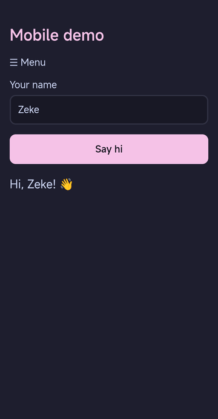
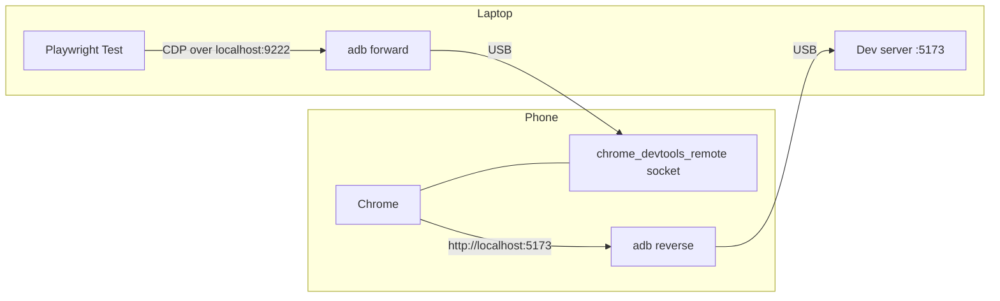

# playwright-android-real-device

Run [Playwright](https://playwright.dev/) end-to-end tests on **Chrome of a real
Android phone connected over USB** — no emulator, no cloud device farm, no
desktop browsers downloaded.



## Why

Desktop "mobile emulation" fakes the viewport and user agent, but it is still a
desktop browser. Real phones differ in rendering, fonts, touch handling and
performance. Device farms work, but they are paid and slow to iterate with.
This repo shows a small, dependency-free way to point Playwright at the phone on
your desk while you develop.

## How it works



1. `adb forward` exposes Chrome's DevTools socket on the phone as
   `localhost:9222` on the laptop, and Playwright connects with
   `chromium.connectOverCDP()`.
2. `adb reverse` makes the phone's `localhost:5173` reach the laptop's dev
   server, so the phone loads your local build without Wi-Fi or IP addresses.
3. Each test gets a fresh tab in the phone's Chrome, which is closed afterwards.
   Your other tabs are left alone.

All of this lives in one fixture: [`tests/phone.js`](tests/phone.js).

## Requirements

- Node.js 18+ and `adb` (Fedora: `sudo dnf install android-tools`,
  Debian/Ubuntu: `sudo apt install adb`, macOS: `brew install android-platform-tools`)
- An Android phone with Chrome installed
- On the phone: **Developer options → USB debugging** enabled, and the computer
  authorized (`adb devices` lists the phone as `device`)

## Quick start

```sh
git clone https://github.com/zekefarioli-arch/playwright-android-real-device.git
cd playwright-android-real-device
PLAYWRIGHT_SKIP_BROWSER_DOWNLOAD=1 npm install   # no desktop browsers needed
npm test
```

```
Running 3 tests using 1 worker
  ✓  1 tests/demo.spec.js:3:1 › greets the user after submitting the form (1.9s)
  ✓  2 tests/demo.spec.js:14:1 › shows the mobile menu on a phone-sized screen (1.4s)
  ✓  3 tests/demo.spec.js:23:1 › reports the real device user agent (1.1s)
  3 passed (6.8s)
```

Other scripts:

| Command | What it does |
|---|---|
| `npm run report` | open the HTML report with every step |
| `npm run site` | serve the demo site on `http://localhost:5173` |
| `npm run phone` | mirror the phone with [scrcpy](https://github.com/Genymobile/scrcpy) to watch the tests run |

## Testing your own site

1. Point `webServer.command` and `webServer.url` in
   [`playwright.config.js`](playwright.config.js) at your dev server, and set
   `PORT` if it is not 5173.
2. Write tests with the `test`, `expect` and `SITE` exports of `tests/phone.js`:

```js
const { test, expect, SITE } = require('./phone');

test('home page loads on the phone', async ({ page }) => {
  await page.goto(SITE);
  await expect(page.getByRole('heading', { level: 1 })).toBeVisible();
  await page.screenshot({ path: 'screenshots/home.png' });
});
```

## Gotchas (and how the fixture handles them)

- **Background apps are not rendered.** If another app is in the foreground,
  Android stops drawing Chrome, `requestAnimationFrame` never fires and
  Playwright's actionability checks time out. The fixture always brings Chrome
  to the foreground with `am start` before the tests.
- **`tap()` is not available.** The tab comes from Chrome's existing browser
  context, which Playwright does not know is touch-enabled. Use `click()`;
  Chrome on Android handles it the same way.
- **No special permissions.** Input is generated by Chrome itself, so this works
  without extra settings such as Xiaomi's "USB debugging (Security settings)",
  which tools that inject touches (scrcpy control, `adb shell input`) need.
- **One phone, one worker.** Tests run serially (`workers: 1`).

## Project layout

```
site/            demo page and a dependency-free static server
tests/phone.js   fixture: adb forward/reverse, CDP connection, tab per test
tests/*.spec.js  the tests
docs/            README assets
```

## License

[MIT](LICENSE)
