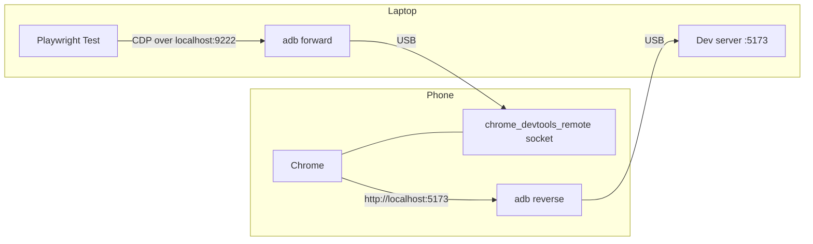

# playwright-android-real-device

This project runs [Playwright](https://playwright.dev/) end-to-end tests on Chrome of a real Android phone connected by USB. It does not use an emulator, a cloud device farm or a desktop browser download; the only requirements are `adb`, Node.js and the phone on my desk.


## Why a real device

Mobile emulation in a desktop browser changes the viewport and the user agent, but the page is still rendered by a desktop engine. In the same way as a photograph of a car does not tell you how it drives, an emulated phone does not show how the page really behaves. The fonts, touch handling and performance of the device are still missing. Device farms solve this, but they are paid and slow to iterate with while I am developing.

I built this project to test my own pages on the phone I already own, with the same Playwright API I use on the desktop. The main limitation is that it covers one device at a time, so it complements a device farm for release testing; it does not replace it.

## How it works

The idea is to make the laptop and the phone see each other through the USB cable, in both directions.



First, `adb forward` exposes the DevTools socket of Chrome on the phone as `localhost:9222` on the laptop, and Playwright connects to it with `chromium.connectOverCDP()`. Second, `adb reverse` does the opposite: when the phone opens `http://localhost:5173`, the request travels through the cable to the dev server on the laptop. Thus, the phone loads my local build without Wi-Fi, IP addresses or a deployment.

For each test, the fixture opens a fresh tab in the phone's Chrome and closes it at the end, so the tabs I already had open stay untouched. All this logic lives in a single file, [`tests/phone.js`](tests/phone.js), which keeps the tests themselves identical to normal Playwright tests.

## Requirements

You need Node.js 18 or newer and `adb`. On Fedora it comes with `sudo dnf install android-tools`; on Debian or Ubuntu, `sudo apt install adb`; on macOS, `brew install android-platform-tools`.

On the phone, Chrome must be installed and **Developer options → USB debugging** must be enabled. The first time the phone is connected, it asks to authorise the computer; after accepting, `adb devices` lists the phone as `device`.

## Quick start

```sh
git clone https://github.com/zekefarioli-arch/playwright-android-real-device.git
cd playwright-android-real-device
PLAYWRIGHT_SKIP_BROWSER_DOWNLOAD=1 npm install   # no desktop browsers needed
npm test
```

On my Xiaomi POCO C85 (Android 15, Chrome 154), the three demo tests take about seven seconds:

```
Running 3 tests using 1 worker
  ✓  1 tests/demo.spec.js:3:1 › greets the user after submitting the form (1.9s)
  ✓  2 tests/demo.spec.js:14:1 › shows the mobile menu on a phone-sized screen (1.4s)
  ✓  3 tests/demo.spec.js:23:1 › reports the real device user agent (1.1s)
  3 passed (6.8s)
```

The first test fills in a form, submits it and checks the greeting. The second one checks that a 360-pixel screen shows the mobile menu instead of the desktop one, and the third one confirms that the browser really is mobile Chrome on Android.

| Command | What it does |
|---|---|
| `npm run report` | opens the HTML report with every step |
| `npm run site` | serves the demo site on `http://localhost:5173` |
| `npm run phone` | mirrors the phone with [scrcpy](https://github.com/Genymobile/scrcpy) to watch the tests run |

## Testing your own site

To test a different site, I change `webServer.command` and `webServer.url` in [`playwright.config.js`](playwright.config.js) so that they start my own dev server, and I set `PORT` if it is not 5173. After that, the tests import `test`, `expect` and `SITE` from the fixture instead of from `@playwright/test`:

```js
const { test, expect, SITE } = require('./phone');

test('home page loads on the phone', async ({ page }) => {
  await page.goto(SITE);
  await expect(page.getByRole('heading', { level: 1 })).toBeVisible();
  await page.screenshot({ path: 'screenshots/home.png' });
});
```

My next step is to copy the fixture into a real web project instead of the demo page, because that is where these tests become useful.

## Problems I found and how the fixture solves them

The hardest problem was a test that timed out on a simple click, even though the button was on the screen. After some debugging, I found that `requestAnimationFrame` was not firing at all: the Settings app was in the foreground, and Android stops rendering an app that is in the background. Playwright waits for an element to be stable before clicking, and it measures stability with animation frames, so it waited forever. For this reason, the fixture now brings Chrome to the foreground with `am start` before the tests run.

Regarding touch, `tap()` is not available, because the tab comes from the existing browser context of Chrome and Playwright does not know that it supports touch. I use `click()` instead, which Chrome on Android handles in the same way. Besides, no special permission is needed, because Chrome itself generates the input events. In contrast, tools that inject touches, such as scrcpy control or `adb shell input`, need extra settings like Xiaomi's "USB debugging (Security settings)".

Finally, there is only one phone, so the tests run one at a time (`workers: 1`). Running them on several devices in parallel would need one worker and one forwarded port per device, which I have not implemented yet.

## Project layout

```
site/            demo page and a static server with no dependencies
tests/phone.js   fixture: adb forward/reverse, CDP connection, one tab per test
tests/*.spec.js  the tests
docs/            README assets
```

## License

[MIT](LICENSE)
